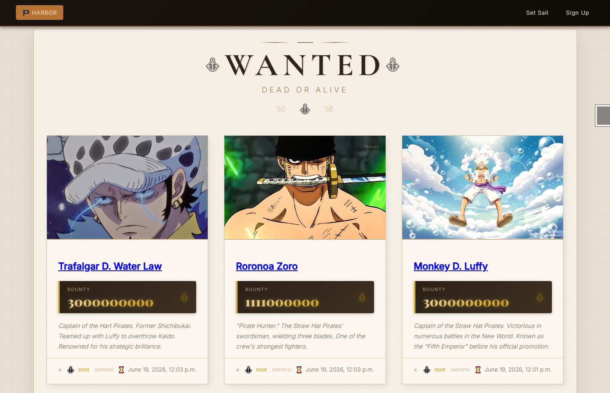
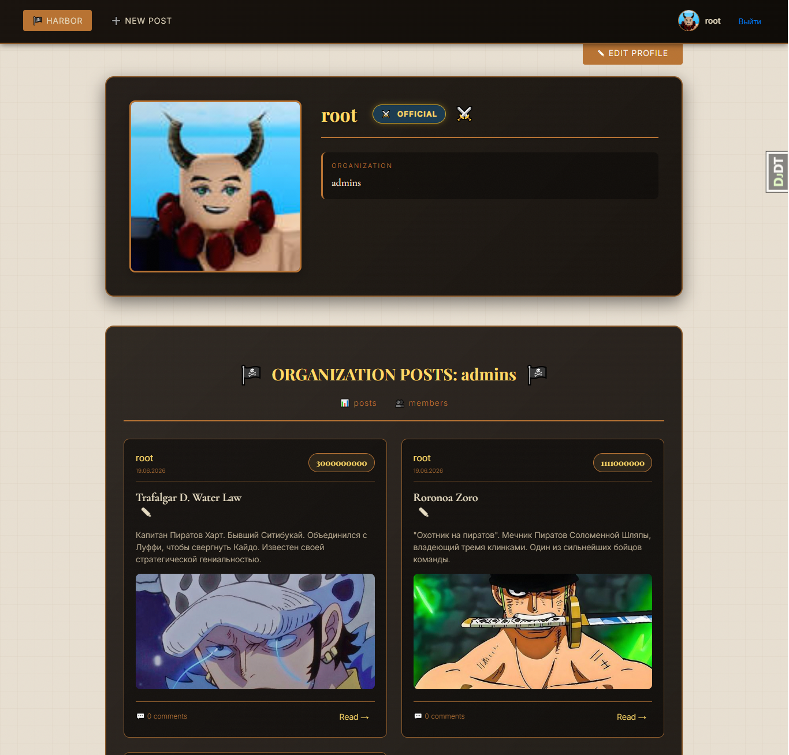
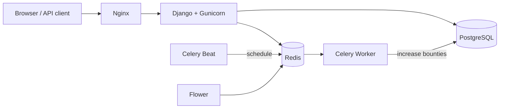

# 🏴‍☠️ One Piece Bounty Board

A Django web app for publishing and tracking **wanted posters** in the One Piece world:
role-based access, comments, a REST API with JWT, and **bounties that grow automatically** via Celery.
Fully containerized with Docker Compose (Postgres, Redis, Celery worker + beat, Flower, Nginx).

<!-- Add 2–3 screenshots to docs/screenshots/ -->
| Wanted board | Poster page | Profile |
|---|---|---|
|  |  |  |

---

## ✨ Features

- 📜 **Wanted posters** — title, description, bounty (Berry), image (auto-resized to 600px with Pillow)
- 👥 **Roles & permissions** — User / Pirate / Hunter / Official / Admin
- 🏛️ **Organizations** — officials publish posters on behalf of their organization
- 💬 **Comments** with images, for signed-in users
- 📈 **Auto bounty increase** — per-poster rules (percent + interval), executed by Celery Beat
- 🔌 **REST API** — DRF viewsets, JWT auth, filtering, pagination, Swagger / ReDoc docs
- 🐳 **Production-style deployment** — Docker Compose, Gunicorn, Nginx, WhiteNoise

## 🛠️ Tech Stack

| Layer | Tools |
|---|---|
| Backend | Python, Django 5, Django REST Framework, SimpleJWT, django-filter, drf-yasg |
| Background jobs | Celery (worker + beat), Redis, Flower |
| Database | PostgreSQL (Docker) |
| Infra | Docker Compose, Gunicorn, Nginx, WhiteNoise |

## 🏗️ Architecture



---

## 👥 Roles

| Role | Create posters | Edit own | Edit any | How to get it |
|---|:---:|:---:|:---:|---|
| User / Pirate / Hunter | ❌ | ❌ | ❌ | switch freely in profile |
| Official | ✅ | ✅ (own organization) | ❌ | assigned by admin, requires organization |
| Admin | ✅ | ✅ | ✅ | assigned by admin, organization `admins` set automatically (signal) |

## 📈 Auto Bounty Increase

Each poster can have a `PostBountyAuto` config: `enabled`, `percent`, `interval_days`, `last_run`.

Celery Beat runs `check_all_posts_bounties` every day at 00:00 UTC. For every enabled poster whose interval has passed:

```
new_bounty = bounty + bounty * percent / 100
```

Then `last_run` is updated. Tasks use retries and time limits.

## 🔌 REST API

| Endpoint | Description |
|---|---|
| `POST /api/token/` | get JWT access + refresh tokens |
| `POST /api/token/refresh/` | refresh access token |
| `/api/posts/` | wanted posters (CRUD) |
| `/api/comments/` | comments |
| `/api/profiles/` | pirate profiles |
| `/swagger/`, `/redoc/` | interactive API docs |

Read access is public; writing requires a JWT (`Authorization: Bearer <token>`).

---

## 🚀 Run with Docker

```bash
git clone https://github.com/lumecather/One-Piece-Bounty-Board.git
cd One-Piece-Bounty-Board/noob

cp .env.example .env        # then set SECRET_KEY and ALLOWED_HOSTS
docker compose up -d --build
docker compose exec web python manage.py migrate
docker compose exec web python manage.py createsuperuser
```

- Site: http://localhost
- Admin: http://localhost/admin
- Flower: http://localhost:5555

## 💻 Run locally (without Docker)

```bash
cd noob
python -m venv venv && venv\Scripts\activate     # Linux/macOS: source venv/bin/activate
pip install -r requirements.txt
cp .env.example .env                              # DATABASE_URL can be sqlite:///db.sqlite3
python manage.py migrate
python manage.py runserver

# in separate terminals (Redis must be running):
celery -A noob worker -l info
celery -A noob beat -l info
```

## 📦 Environment variables

| Variable | Example |
|---|---|
| `DEBUG` | `False` |
| `SECRET_KEY` | `your-secret-key` |
| `ALLOWED_HOSTS` | `localhost,127.0.0.1,your-domain.com` |
| `DATABASE_URL` | `postgres://pirate_user:pirate_password@db:5432/pirate_db` |
| `REDIS_URL` | `redis://redis:6379/0` |
| `FLOWER_USER`, `FLOWER_PASSWORD` | Flower basic auth |

## ⚠️ Before real production

- [ ] Strong `SECRET_KEY`, `DEBUG=False`, real `ALLOWED_HOSTS`
- [ ] Change the default Postgres password in `docker-compose.yml`
- [ ] Don't expose Redis (`6379`) and Flower (`5555`) ports publicly
- [ ] HTTPS (Let's Encrypt), database backups, error logging (Sentry)

---

> Fun fact: the folders are called `noob` and `nob` because this started as a practice project —
> and then it grew into something worth showing. 🏴‍☠️

## License

MIT
